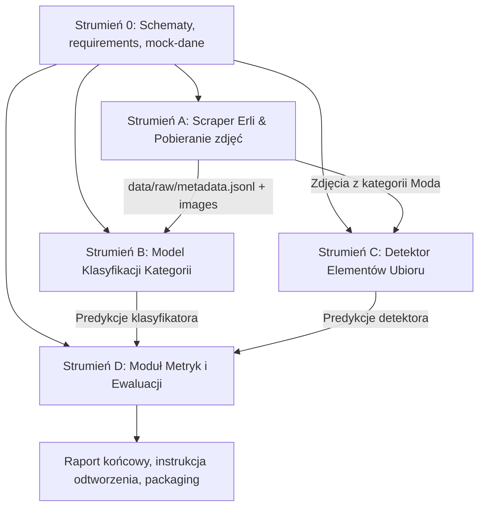

# Plan Realizacji Projektu ERLI-Rekrut

## 1. Cel i Wymagania Projektu
Projekt polega na stworzeniu prototypowego pipeline'u ML/CV dla platformy e-commerce Erli:
1. **Pobranie reprezentatywnej próbki produktów** ze wszystkich kategorii głównych Erli wraz ze zdjęciami i metadanymi.
2. **Klasyfikacja obrazów do kategorii głównych** (priorytet biznesowy) z ewaluacją jakości, szybkości oraz analizą błędów.
3. **Detekcja elementów ubioru** (bounding boxes + etykiety) na zdjęciach z kategorii modowej.
4. **Raport końcowy**: wnioski, ograniczenia, propozycje rozwoju produkcyjnego i instrukcja odtworzenia.

---

## 2. Architektura i Kontrakty Danych (Klucz do Równoległości)

Aby agenci mogli pracować **równolegle bez wzajemnego blokowania**, ustalamy z góry standardy katalogów i schematy danych:

```
ERLI-Rekrut/
├── data/
│   ├── raw/
│   │   ├── <kategoria_glowna>/            # Np. Moda, Elektronika, Dom i Ogród (istniejące 12 folderów)
│   │   │   └── <podkategoria_stopien_1>/  # Np. Odzież damska, Telefony i akcesoria
│   │   │       └── <product_id>.jpg
│   │   └── metadata.jsonl                 # Główny plik metadanych zebranych próbek
│   └── samples/                           # Mini-zestaw mockowy (5-10 zdjęć) do testów jednostkowych
├── src/
│   ├── common/                            # Wspólne typy, config, logger
│   │   ├── schemas.py                     # Pydantic / Dataclasses dla rekordów
│   │   └── config.py
│   ├── scrapper/                          # Strumień 1: Pobieranie danych
│   │   ├── erli_client.py
│   │   └── sample_collector.py
│   ├── classification/                    # Strumień 2: Klasyfikacja kategorii
│   │   ├── dataset.py
│   │   ├── model.py                       # SigLIP / CLIP / ViT / ResNet
│   │   └── predict.py
│   ├── detection/                         # Strumień 3: Detekcja ubioru
│   │   ├── detector.py                    # YOLO / DeepFashion / Grounding
│   │   └── visualize.py
│   └── evaluation/                        # Strumień 4: Ewaluacja i benchmarki
│       ├── metrics.py                     # F1, Accuracy, Latency, Confusion Matrix
│       └── benchmark.py
├── reports/                               # Wygenerowane wykresy, macierze, podsumowania
├── requirements.txt
└── README.md
```

### Kontrakt Danych: `metadata.jsonl`
Każdy wiersz w `data/raw/metadata.jsonl`:
```json
{
  "product_id": "123456",
  "title": "Przykładowy produkt",
  "category_main": "Moda",
  "category_sub1": "Odzież damska",
  "category_path": ["Moda", "Odzież damska", "Sukienki"],
  "image_url": "https://...",
  "local_image_path": "data/raw/Moda/Odzież damska/123456.jpg",
  "price": 129.99,
  "downloaded_at": "2026-10-19T18:30:00Z"
}
```

---

## 3. Podział Zadań na Niezależne Strumienie (Agenci)

### Strumień 0: Fundament i Środowisko (Wspólny start)
- [x] Oczyszczenie `.gitignore` i usunięcie `.idea/` ze staging area gita.
- [x] Przygotowanie `requirements.txt` (torch, torchvision, pillow, requests/httpx, pydantic, scikit-learn, matplotlib, pandas, ultralytics / transformers).
- [x] Utworzenie `src/common/schemas.py` z modelem danych produktu oraz mini-zestawu mockowego w `data/samples/`.
- [x] Utworzenie `src/common/config.py` z 12 kategoriami głównymi i testów w `tests/test_schemas.py`.

---

### Strumień A (Agent 1): Pobieranie i Próbkowanie Danych (`src/scrapper`)
- [x] **Zadanie A1**: Analiza struktury kategorii Erli (kategorie główne: 12 kategorii, mapowanie drzewa w `src/scrapper/category_tree.py` i `data/category_tree.json`).
- [x] **Zadanie A2**: Implementacja klienta pobierającego (`src/scrapper/erli_client.py` z obsługą sesji, rate-limitów, konwersji zdjęć i natywnego TLS).
- [x] **Zadanie A3**: Strategia próbkowania:
  - Zbalansowana liczba produktów per kategoria główna (obecnie cel 35 produktów x 12 = 420 produktów z podziałem na podkategorie 1. stopnia).
  - Skalowalność do setek/tysięcy przez parametr `--target-per-category`.
- [x] **Zadanie A4**: Zapis zdjęć do `data/raw/<kategoria_glowna>/<podkategoria_stopien_1>/` oraz metadanych do `data/raw/metadata.jsonl` ze wsparciem dla multi-label (`additional_categories`).

---

### Strumień B (Agent 2): Klasyfikator Kategorii (`src/classification`)
*Zrealizowany i zoptymalizowany dla scenariuszy Multi-Label.*
- [x] **Zadanie B1**: Moduł wczytywania danych (`ProductDataset`, walidacja poprawności plików graficznych, stratyfikowany podział `create_train_val_test_split`).
- [x] **Zadanie B2**: Dobór i implementacja modeli:
  - *SigLIP (Google, `google/siglip-base-patch16-224`)*: Architektura Vision-Language z sigmoid loss – natywne wsparcie dla multi-label, precyzyjnie skalibrowane logity bez arbitralnego biasu WebLI.
  - *CLIP (OpenAI, `openai/clip-vit-base-patch32`)*: Architektura baseline z softmax loss.
  - *Linear Probe (One-vs-Rest Logistic Regression)*: Głowica nadzorowana uczona na zamrożonych embeddingach SigLIP.
- [x] **Zadanie B3**: Pipeline inferencji jedno- i wielo-obrazowej (`predict_category(image) -> CategoryPrediction`).
- [x] **Zadanie B4**: Zapis predykcji wraz z poziomem pewności (confidence/probabilities) i czasem inferencji do JSONL.
- [x] **Zadanie B5 (Multi-label Ready)**: Pełna obsługa multi-label:
  - Progowanie sigmoidalne (thresholding >= 0.35).
  - Wykrywanie nakładających się kategorii (np. odzież sportowa = Moda + Sport i turystyka).

---

### Strumień C (Agent 3): Detekcja Elementów Ubioru (`src/detection`)
*Zrealizowany i zoptymalizowany pod GPU CUDA oraz architekturę kolejkową RabbitMQ.*
- [x] **Zadanie C1**: Wybór modelu detekcji modowej:
  - Wdrożono model **YOLO-World (`yolov8s-worldv2.pt`)** – architekturę Vision-Language (Open-Vocabulary Object Detection) z bogatym słownikiem 28 klas ubrań (sukienki, buty, torebki, kurtki, spodnie, nakrycia głowy itp.) i polskim mapowaniem.
- [x] **Zadanie C2**: Implementacja `FashionDetector` ([src/detection/detector.py](file:///c:/Users/User/PycharmProjects/ERLI-Rekrut/src/detection/detector.py)):
  - Obsługa pojedynczego obrazu oraz batchowania na GPU CUDA z pamięciowym bezpieczeństwem ($O(1)$ VRAM).
- [x] **Zadanie C3**: Moduł wizualizacji ([src/detection/visualize.py](file:///c:/Users/User/PycharmProjects/ERLI-Rekrut/src/detection/visualize.py)):
  - Semantyczna paleta barw, zaokrąglone ramki i etykiety tekstowe (PL/EN) z pewnością detekcji oraz automatyczna mozaika do raportów (`reports/fashion_detection_mosaic.jpg`).
- [x] **Zadanie C4**: Benchmarking i integracja z RabbitMQ:
  - Skrypt benchmarku [src/detection/benchmark_detection.py](file:///c:/Users/User/PycharmProjects/ERLI-Rekrut/src/detection/benchmark_detection.py) (osiągnięto **82.7 FPS, 12.1 ms na obraz** na RTX 3070).
  - Dedykowany worker RabbitMQ [src/queue/detection_worker.py](file:///c:/Users/User/PycharmProjects/ERLI-Rekrut/src/queue/detection_worker.py) dla kolejki `erli_product_detection`.


---

### Strumień D (Agent 4): Ewaluacja, Analiza Błędów i Raport (`src/evaluation` + Raporty)
*Zrealizowany i zintegrowany ze Strumieniem B.*
- [x] **Zadanie D1**: Implementacja metryk klasyfikacji:
  - Top-1 Accuracy, Top-3 Accuracy, Balanced Accuracy, Precision, Recall, Macro/Weighted F1, Multi-Label Jaccard Index, Hamming Loss.
  - Generowanie macierzy pomyłek (Confusion Matrix) w formacie tekstowym ASCII oraz graficznym PNG (`reports/confusion_matrix_*.png`).
- [x] **Zadanie D2**: Moduł pomiaru wydajności (Profiling):
  - Dokładny pomiar latencji per-item (ms) oraz przepustowości (FPS).
- [x] **Zadanie D3**: Moduł analizy błędów:
  - Zapis błędów i wykrytych przypadków multi-label do `reports/error_analysis_*.json`.
  - Identyfikacja zjawiska Label Noise na rzeczywistych danych Erli (np. dekoracje ślubne / pudełka na ciasto zaklasyfikowane przez sprzedawców do kategorii "Moda").
- [x] **Zadanie D4**: Raport porównawczy Markdown i JSON (`reports/classification_report.md`, `reports/benchmark_summary.json`).

---

## 4. Harmonogram i Zależności (Diagram)


