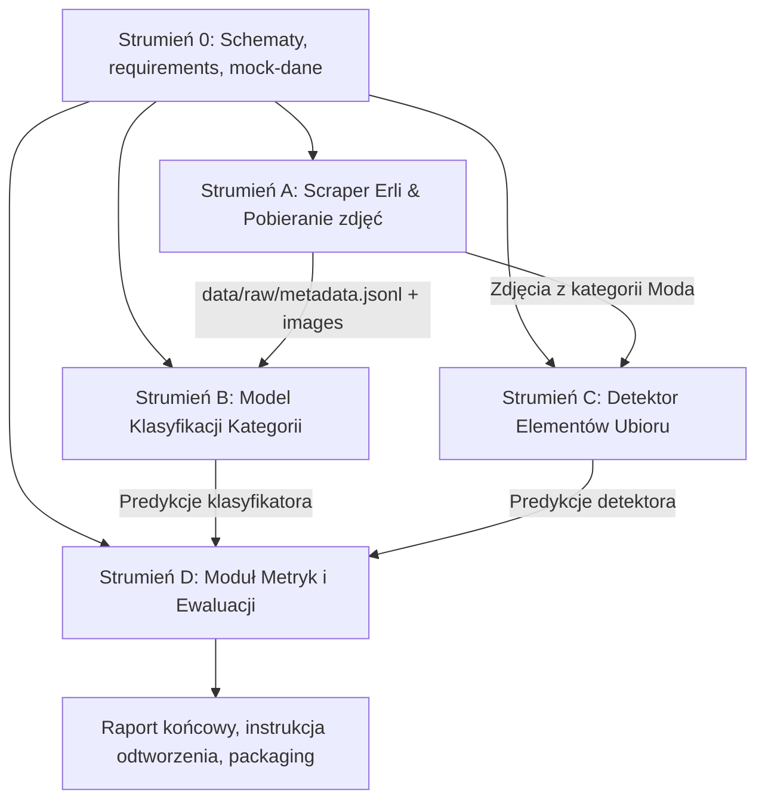

# Plan Realizacji Projektu ERLI-Rekrut

## 1. Cel i Wymagania Projektu
Projekt polega na stworzeniu prototypowego pipeline'u ML/CV dla platformy e-commerce Erli:
1. **Pobranie reprezentatywnej próbki produktów** ze wszystkich kategorii głównych Erli wraz ze zdjęciami i metadanymi.
2. **Klasyfikacja obrazów do kategorii głównych** (priorytet biznesowy) z ewaluacją jakości, szybkości oraz analizą błędów.
3. **Detekcja elementów ubioru** (bounding boxes + etykiety) na zdjęciach z kategorii modowej.
4. **Raport końcowy**: wnioski, ograniczenia, propozycje rozwoju produkcyjnego i instrukcja odtworzenia.

---

## 2. Architektura i Kontrakty Danych (Klucz do Równoległości)

Aby agenci mogli pracować **równolegle bez wzajemnego blokowania**, ustalamy z góry standardy katalogów i schematy danych:

```
ERLI-Rekrut/
├── data/
│   ├── raw/
│   │   ├── <kategoria_glowna>/            # Np. Moda, Elektronika, Dom i Ogród (istniejące 12 folderów)
│   │   │   └── <podkategoria_stopien_1>/  # Np. Odzież damska, Telefony i akcesoria
│   │   │       └── <product_id>.jpg
│   │   └── metadata.jsonl                 # Główny plik metadanych zebranych próbek
│   └── samples/                           # Mini-zestaw mockowy (5-10 zdjęć) do testów jednostkowych
├── src/
│   ├── common/                            # Wspólne typy, config, logger
│   │   ├── schemas.py                     # Pydantic / Dataclasses dla rekordów
│   │   └── config.py
│   ├── scrapper/                          # Strumień 1: Pobieranie danych
│   │   ├── erli_client.py
│   │   └── sample_collector.py
│   ├── classification/                    # Strumień 2: Klasyfikacja kategorii
│   │   ├── dataset.py
│   │   ├── model.py                       # SigLIP / CLIP / ViT / ResNet
│   │   └── predict.py
│   ├── detection/                         # Strumień 3: Detekcja ubioru
│   │   ├── detector.py                    # YOLO / DeepFashion / Grounding
│   │   └── visualize.py
│   └── evaluation/                        # Strumień 4: Ewaluacja i benchmarki
│       ├── metrics.py                     # F1, Accuracy, Latency, Confusion Matrix
│       └── benchmark.py
├── reports/                               # Wygenerowane wykresy, macierze, podsumowania
├── requirements.txt
└── README.md
```

### Kontrakt Danych: `metadata.jsonl`
Każdy wiersz w `data/raw/metadata.jsonl`:
```json
{
  "product_id": "123456",
  "title": "Przykładowy produkt",
  "category_main": "Moda",
  "category_sub1": "Odzież damska",
  "category_path": ["Moda", "Odzież damska", "Sukienki"],
  "image_url": "https://...",
  "local_image_path": "data/raw/Moda/Odzież damska/123456.jpg",
  "price": 129.99,
  "downloaded_at": "2026-10-19T18:30:00Z"
}
```

---

## 3. Podział Zadań na Niezależne Strumienie (Agenci)

### Strumień 0: Fundament i Środowisko (Wspólny start)
- [x] Oczyszczenie `.gitignore` i usunięcie `.idea/` ze staging area gita.
- [x] Przygotowanie `requirements.txt` (torch, torchvision, pillow, requests/httpx, pydantic, scikit-learn, matplotlib, pandas, ultralytics / transformers).
- [x] Utworzenie `src/common/schemas.py` z modelem danych produktu oraz mini-zestawu mockowego w `data/samples/`.
- [x] Utworzenie `src/common/config.py` z 12 kategoriami głównymi i testów w `tests/test_schemas.py`.

---

### Strumień A (Agent 1): Pobieranie i Próbkowanie Danych (`src/scrapper`)
- [x] **Zadanie A1**: Analiza struktury kategorii Erli (kategorie główne: 12 kategorii, mapowanie drzewa w `src/scrapper/category_tree.py` i `data/category_tree.json`).
- [x] **Zadanie A2**: Implementacja klienta pobierającego (`src/scrapper/erli_client.py` z obsługą sesji, rate-limitów, konwersji zdjęć i natywnego TLS).
- [x] **Zadanie A3**: Strategia próbkowania:
  - Zbalansowana liczba produktów per kategoria główna (obecnie cel 35 produktów x 12 = 420 produktów z podziałem na podkategorie 1. stopnia).
  - Skalowalność do setek/tysięcy przez parametr `--target-per-category`.
- [x] **Zadanie A4**: Zapis zdjęć do `data/raw/<kategoria_glowna>/<podkategoria_stopien_1>/` oraz metadanych do `data/raw/metadata.jsonl` ze wsparciem dla multi-label (`additional_categories`).

---

### Strumień B (Agent 2): Klasyfikator Kategorii (`src/classification`)
*Może pracować równolegle ze Strumieniem A (korzysta z mocków ze Strumienia 0, a po ukończeniu A przełącza się na pełne dane).*
- **Zadanie B1**: Moduł wczytywania danych (`ProductDataset`, walidacja poprawności plików graficznych, obsługa braków/błędnych formatów).
- **Zadanie B2**: Dobór i implementacja modelu:
  - *Opcja A (Rekomendowana dla prototypu z małą próbką)*: Zero-shot / Few-shot Vision-Language Model (np. `google/siglip-base-patch16-224` lub `openai/clip-vit-base-patch32`) – natychmiastowa gotowość bez długiego trenowania, wysoka uogólnialność na kategorie e-commerce.
  - *Opcja B (Baseline)*: Lekki transfer learning (np. fine-tuning warstwy liniowej na embeddingach SigLIP / ResNet50 / MobileNetV3).
- **Zadanie B3**: Pipeline inferencji jedno- i wielo-obrazowej (`predict_category(image) -> CategoryPrediction`).
- **Zadanie B4**: Zapis predykcji wraz z poziomem pewności (confidence/probabilities) do dalszej ewaluacji.
- **Zadanie B5 (Multi-label Ready)**: Przygotowanie pipeline'u na przypadek multi-label:
  - Progowanie sigmoidalne (thresholding na poziomie np. >= 0.35 dla wielu kategorii równocześnie).
  - Wykrywanie nakładających się kategorii (np. Moda + Sport, Dziecko + Zabawki/Elektronika) i zapis listy `predicted_categories`.

---

### Strumień C (Agent 3): Detekcja Elementów Ubioru (`src/detection`)
*Zgodnie z ustaleniami: realizowany na samym końcu, po pełnym wdrożeniu i opisaniu Strumieni A i B.*
*Może pracować całkowicie niezależnie od klasyfikatora.*
- **Zadanie C1**: Wybór pretrenowanego modelu detekcji modowej:
  - Np. YOLOv8/YOLO11 z wagami COCO (klasy: person, tie, handbag, suitcase, backpack) lub wyspecjalizowany model zorientowany na modę (np. Fashionpedia / DeepFashion2 weights lub OWL-ViT / Grounding DINO dla detekcji otwartej typu `dress`, `jacket`, `pants`, `shoes`, `shirt`).
- **Zadanie C2**: Implementacja `FashionDetector`:
  - Przyjmowanie obrazu -> zwracanie listy detekcji: `[BBox(x1, y1, x2, y2, label, confidence)]`.
- **Zadanie C3**: Moduł wizualizacji:
  - Rysowanie bounding boxów, kolorowanie według kategorii ubrań, zapis przykładowych wyników do `reports/detections/`.
- **Zadanie C4**: Benchmarking latencji detektora na CPU/GPU.

---

### Strumień D (Agent 4): Ewaluacja, Analiza Błędów i Raport (`src/evaluation` + Dokumentacja)
*Działa równolegle – najpierw tworzy skrypty ewaluacji na danych mockowych, a na koniec generuje finalny raport.*
- **Zadanie D1**: Implementacja metryk klasyfikacji:
  - Accuracy, Balanced Accuracy, Precision, Recall, F1 (macro/weighted).
  - Generowanie macierzy pomyłek (Confusion Matrix) i wykresów w `matplotlib/seaborn`.
- **Zadanie D2**: Moduł pomiaru wydajności (Profiling):
  - Pomiar czasu inferencji (średnia, p95, p99, throughput FPS).
- **Zadanie D3**: Moduł analizy błędów:
  - Wyszukiwanie top-k najbardziej niepewnych i błędnych predykcji.
  - Analiza jakościowa: dlaczego model się myli (np. wieloznaczne tło, akcesoria, kategoria "Dziecko" vs "Moda").
- **Zadanie D4**: Raport końcowy (`FINAL_REPORT.md` / wnioski):
  - Co działa, a co nie.
  - Rekomendacje rozwoju produkcyjnego (MLOps, feature store, vector search, active learning).
  - Wymogi pracy zespołowej (lintery, testy CI, wersjonowanie danych DVC).
  - Deklaracja użycia narzędzi AI.

---

## 4. Harmonogram i Zależności (Diagram)


